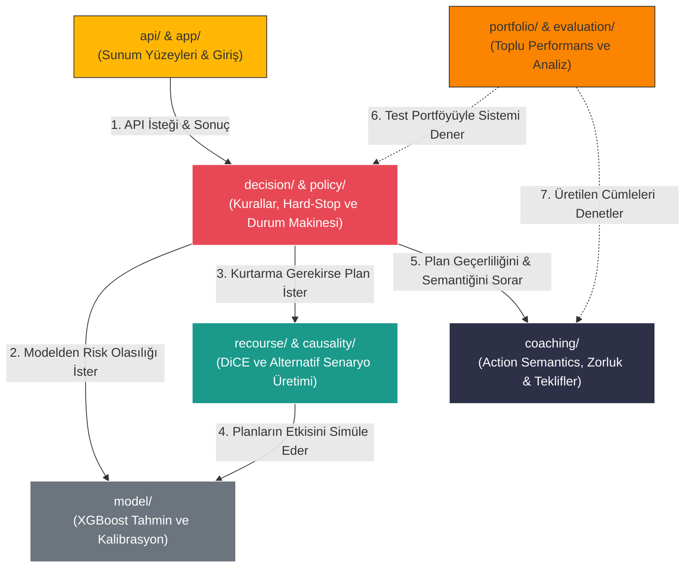

# Klasör & Modül Bağımlılık Haritası (Component Diagram)

Bu (Bileşen/Klasör) diyagramı, `credit-coach/src/credit_coach` altındaki ana modüllerin birbirleriyle olan hiyerarşik ilişkisini ve Credit Coach'un temel sorumluluklarını hangi klasörlere dağıttığını gösterir. Özellikle projeye yeni katılan geliştiriciler için **kod hizalanması (codebase onboarding)** rehberidir.

---

## Klasörlerin Görevleri (Notes)

### 1. `api/` & `app/` (Sunum Yüzeyleri)
Dış dünyanın veya web arayüzünün (Credit-Coach Website) sisteme temas ettiği katmandır. Müşteri verisi REST API / CLI üzerinden buraya ulaşır; ancak bu modüllerin kendi başına bir karar yetkisi yoktur, sadece `decision` katmanına aracılık eder.

### 2. `decision/` & `policy/` (Orkestrasyon ve Durum)
Uygulamanın orkestra şefi ve kural koyucusudur. Onay (`Tau`) sınırlarının uygulandığı, Winner Integrity (Phase 45-48 Hard Stop Kuralları) mantıklarının kilitlendiği ana yerdir. Diğer modülleri çağırır, çıkan cevabın dışarıya sızıp sızmayacağına burası karar verir (`APPROVED`, `REJECTED`, `CONDITIONAL`).

### 3. `model/` (Tahmin Motoru)
Sadece risk hesabına (PD) odaklanır. Veriyi XGBoost veya Linear modellere sokar, kalibrasyonu yapar ve salt bir güvenlik puanı çıkartır. İçerisinde iş kuralı barındırmaz.

### 4. `recourse/` & `causality/` (Planlama Laboratuvarı)
Machine Learning destekli planlama ajanı (DiCE) burada koşar. Yüksek riskli profili onaylanabilir bir profile dönüştürmek için matematiksel permütasyonlar dener ve bol miktarda ham senaryo çıkartır.

### 5. `coaching/` (Çevirmen ve Fizibilite)
Sayıları insan diline ve gerçek dünyaya bağlar.
*   **Action Semantics:** Dönen sayıları ("Feature X %20 artmalı") -> ("Limitsiz kredi kullanımını azalt") cümlesine döndürür.
*   **Execution & Feasibility:** Senaryonun aslında mantıksız olup olmadığı, çok para/zorluk gerektirip gerektirmediği yine burada hesaplanır.

### 6. `portfolio/` & `evaluation/` (Denetçi)
Hiçbir tekil müşteriye (canlı sisteme) doğrudan karışmaz. Çevrimdışı (Offline) çalışarak `test.parquet` gibi dev verileri sisteme sokar ve sistemin genel mantıksal performansını / kapsama oranlarını ölçer.
