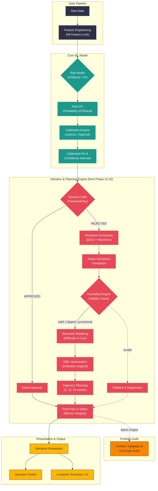

# Yüksek Seviye Sistem Mimarisi (High-Level Architecture)

Credit Coach sisteminin uçtan uca akışı, veri girişinden nihai sunum ekranlarına kadar 5 ana katmana ayrılır. Aşağıdaki diyagram, bu katmanlar arasındaki ilişkiyi ve veri akışını özetlemektedir.

---

## Bileşenlerin Görevleri ve Açıklamaları

### 1. Veri Katmanı (Data Pipeline)
Analiz için 48 özellik kilidinin işletildiği ana merkezdir. Müşteri verileri, algoritmaların tutarlı kararlar alabilmesi için temizlenir ve kilitli özellik setine çevrilir.

### 2. Çekirdek Model (Core ML Model)
Tahmin yapan motordur. **XGBoost** veya **LR** ile kişinin geri ödeyememe ihtimali (PD) sayısal olarak bulunur. Isotonic ve Sigmoid **kalibrasyon** adımlarıyla bu oranların gerçekliği artırılır. Kesin rakam yerine "güven bandı" ile desteklenen PD üretilir.

### 3. Karar ve Planlama Motoru (Decision & Planning Engine)
**Sistemin kalbini oluşturan katmandır.** "Bu kişi reddedildi, peki ne yaparsa onaylanır?" sorusuna yanıt üretilir:
- **Recourse Generation (DiCE vb.):** Farklı olasılıklar kurgulayarak bir alternatif kurtarma planı (action plan) üretir.
- **Action Semantics:** `"Mevcut kart limiti kullanımı %85'ten %40'a düşmeli"` denilen teknik ifadeyi business anlayışına ("Kredi kartı kullanılabilirliğini artır.") çevirir.
- **Feasibility Engine & Execution:** Hedeflenen plan işe yarar olabilir ama "gerçekte uygulanabilir mi?", maliyeti ve ağırlığı nedir diye tartılır.
- Burada bir hard-stop olan **Winner Integrity** kalkanı sayesinde hatalı, mantıksız (invalid) hiçbir plan dışarı aktarılmaz.

### 4. Sunum ve Çıktı (Presentation & Output)
Tüm karmaşık analiz verileri; iş/yatırım dili ve nihai müşteri arayüzü formlarına dökülür. **Narrative Generation** sayesinde müşteri planları, analistin inceleyeceği paket (Operator Packet) dili oluşturulup dışarı servis edilir.

### 5. Portföy Kontrolü (Portfolio Validation)
Geliştirilen sistemin sadece tek kişide harika karar vermekle kalmayıp kitlesel olarak (örneğin 100 kişi için) tutarlı oranlarda kalıp kalmadığını, hangi segmentleri kapsadığını ve ne denli başarılı "gerçekleştirilebilir" aksiyonlar yarattığını izleyen batched mekanizmadır.
