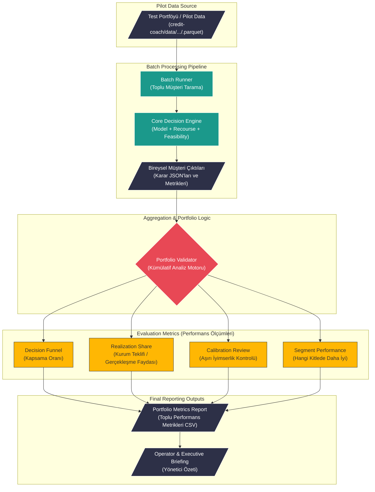

# Portföy ve Pilot Simülasyon Akışı (Data Flow)

Bu veri akış (Data Flow) diyagramı, Credit Coach sisteminin tek bir müşteri yerine toplu portföy verileri (Parquet/CSV) ile çalışırken pilot simülasyonları **(Batch Processing)** nasıl yürüttüğünü ve başarısını nasıl kanıtladığını gösterir.

---

## Veri Akışı Aşamaları (Notes)

### 1. Data Input (Pilot Veri Kaynağı)
Uygulama canlıya alınmadan önce, gerçeğe çok yakın temizlenmiş müşteri verilerini içeren Parquet veya CSV dosyaları (`test.parquet`) sisteme sunulur. Bu, 50, 100 veya 10.000 müşteriyi içerebilir.

### 2. Batch Processing Pipeline (Toplu İşlem)
`Batch Runner`, tek tek binlerce müşteriyi Credit Coach'un kalbine (**Core Decision Engine**) sokar. 
*   Her bir kişi için Risk Hesabı, Recourse İhtimali ve Feasibility değerlendirilir.
*   Her kullanıcı için süreç tamamlandığında sistem bireysel *Artifacts* (tekil log ve JSON dosyaları) basar. 

### 3. Aggregation (Toplama ve İnceleme)
`Portfolio Validator` katmanı, alt tarafta 1000 ayrı `CONDITIONAL` veya `REJECTED` var ise bunları toplar. Amacı şudur: *"Evet, tek bir kişide güzel plan önerdik ama acaba bu 1000 kişinin %90'ına aşırı iyimser (yapılamaz) tavsiyeler mi verdik?"* sorusunu sormak.

### 4. Evaluation Metrics (Performans Ölçümleri)
Bu aşamada şu metrikler veri hattından geçer:
*   **Decision Funnel:** Giren müşteri sayısının yüzde kaçına `APPROVED`, kaçına kurtarma (`CONDITIONAL`), kaçına `REJECTED` denildiği.
*   **Realization Share:** Önerilerin gerçek maliyet-fayda analizi. Kurum tekliflerinin (Offer) genel iyileşmedeki payı.
*   **Calibration Review:** Sonuçların veriye ve gerçeklere ne kadar uygun olduğu kontrol edilir (Aşırı iyimserlik filtrelenir).

### 5. Final Reporting (Çıktı ve Raporlama)
Tüm bu istatistikler toplanarak yöneticiler için **Executive Briefing** dokümanlarına ve iş zekası araçlarında kullanılabilecek Portfolio Metrik raporlarına (/`data/processed/...` output dosyalarına) kaydedilir.
