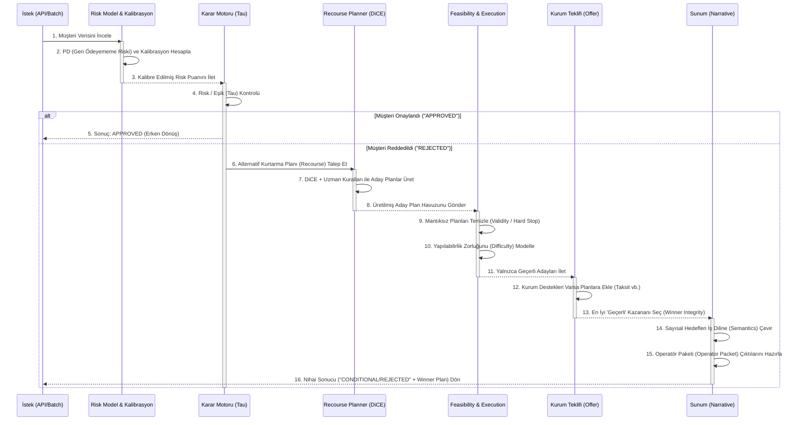

# Model ve Recourse Etkileşim Akışı (Sequence Diagram)

Bu diyagram, Credit Coach sistemine bir risk inceleme isteği (örneğin API üzerinden) geldiğinde, müşterinin otomatik onay almaması (`REJECTED` bandında kalması) koşulunda sistemin **kurtarma planlarını (Recourse)** nasıl tetiklediğini ve son karar özetini nasıl oluşturduğunu adım adım (zaman çizelgesinde) göstermektedir.

---

## Sıralı Katmanların Görevleri (Notes)

### 1-5 Arası (Risk Değerleme & Basit Onay):
Müşteri verisinin girip ilk "karar/eşik (Tau)" duvarına çarptığı yer burasıdır.
Model, `XGBoost` üzerinden tahminleme yapar. Kalibrasyon sonrasında müşteri risk puanı eşiğin altındaysa, **Recourse katmanları (DiCE vs.) boşa çalıştırılmadan ("APPROVED" cevabıyla) doğrudan geri dönülür.**

### 6-9 Arası (Recourse & Feasibility / Kurtarma):
Eğer profil `REJECTED` bölgesindeyse sistem devreye girer:
*   Müşterinin "borç azaltımı", "kredi kartı kapama" ihtimalleri (DiCE) ve uzman kuralları hesaplanarak bol miktarda **Aday Plan** (Candidate Pool) türetilir.
*   **Feasibility (Yapılabilirlik):** Anormal planlar `invalid` olarak işaretlenip (Hard Stop) çöpe atılır, sadece "yapılabilir" planlar (geçerli/provisional) yaşamaya devam eder. (Bkz: Phase 45 Winner Integrity mantığı)

### 10-13 Arası (Execution & En İyi Seçim):
*   Geriye kalanların "ne kadar sürede/maaliyetle" (Execution Difficulty) başarılabileceği çıkarılır.
*   Eğer banka ya da kurum **Özel Bir Teklif** (örneğin %10 indirim veya taksitlendirme) girmişse plana o da yapıştırılır.
*   Bu filtrenin ardından Winner Integrity kurallarına uygun **Tek Bir Kazanan Plan** seçilir.

### 14-16 Arası (Anlatım ve Teslimat):
Makinenin dilindeki sayısal hedefler (`revol_util 68 -> 45`), gişe memurunun anlayacağı **Action Semantics ("Kredi kartı limitini artır / ödemeni düzelt")** metinlerine ve detaylı **Operator Packet** sunum dosyasına (JSON vb.) dönüşür ve istek tarafına (API/CLI) yanıt olarak iletilir.
