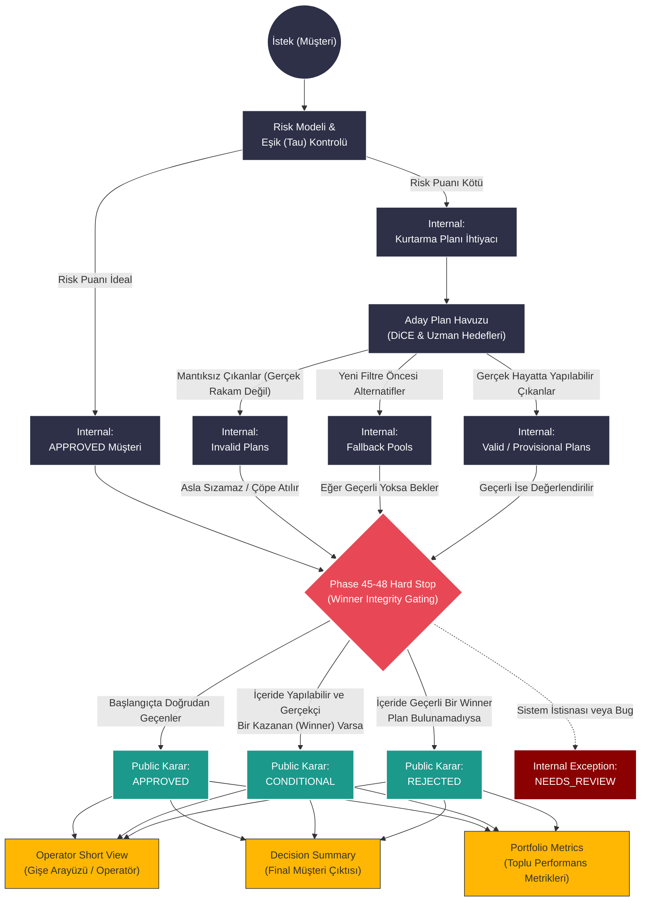

# Karar Sahipliği ve "Winner Integrity" Durum Makinesi (State Machine)

Bu diyagram, sistem içerisindeki ham verilerin (Risk Modelinden çıkan sonuçlar ve DiCE üzerinden gelen aday planlar) sistemde hangi "internal" aşamalardan geçtiğini ve **v2.2 Milestone'unda çözülen en büyük sorunun (Phase 45-48)** sistemden dışarı sızacak verileri "Hard Stop" mantığıyla nasıl sınırlandırdığını anlatır.

---

## Katmanların Özeti ve Roller (Notes)

### 1. Internal States (İç Durumlar)
Müşteri için henüz kesin ve herkesin önünde ilan edilecek bir sonuç yoktur. Bu aşamada sistem olasılıkları tarar:
*   Müşteri doğrudan onaylı havuzda olabilir.
*   Geçersiz sayısal varyasyonlar yüzünden `Invalid Plans` sepetine malzeme yığılmış olabilir.
*   Elde geçerli sonuç yoksa sistem eski `Fallback Pools` tarafında dolaşıyor olabilir.
*   **Aman Dikkat:** Bu evre kapalı kapılar ardındadır.

### 2. Hard Stop / Gate (Phase 45-48 Kuralları)
v2.2 (Winner Integrity) sürümünün en büyük vaadidir. 
*   Geçersiz (invalid) çıkan veya DiCE'ten gelen ama saçma olan hiçbir plan dışarıdaki yüzeylere *sızamaz*. 
*   Eğer bir plan geçerli değilse, sistem o planı "kurtarma" bahanesiyle diriltmez. Planı atar ve eğer başka geçerli seçenek kalmadıysa, sonucu zorla CONDITIONAL yapmak yerine dürüstçe REJECTED üretir.

### 3. Public Final States (Dışarıya Gösterilen Durumlar)
Bu noktada karar mühürlenir. Web sitesine, operatöre ya da final log dosyasına yansıyacak sadece üç net karar (Business-visible states) çıkar:
*   **APPROVED:** Onaylandı.
*   **CONDITIONAL:** Onaylanmadı ama uygulanabilir geçerli bir planı var.
*   **REJECTED:** Onaylanmadı ve gerçekleştirilebilecek mantıklı/geçerli bir kurtarma planı da maalesef bulunamadı.
*   **NEEDS_REVIEW:** Dışa dönük bir karar değildir, içeride kalan ve incelenmesi gereken sistem bug / hata durumlarını toplar (Bu bir Public state değildir!).

### 4. Erişen Yüzeyler (Consumer Surfaces)
Mühürlenen karar, projenin her köşesinde aynı (tek doğrulu) sonucu gösterir:
1.  **Operator Short View:** Ekranın en tepesinde yeşil/sarı/kırmızı olarak gözükür ve sadece 'Geçerli' olan planı öneri olarak sunar.
2.  **Decision Summary:** En son log dosyasındaki JSON ya da CSV satırlarında da aynı ibare ve açıklama bulunur.
3.  **Portfolio Metrics:** Günün sonunda yöneticilere gidecek raporlarda, 100 kişinin kaçı REJECTED, kaçı CONDITIONAL oldu diye tutarlıca toplanır. Bir yerdeki CONDITIONAL plan durumu, başka yerde REJECTED görünmez (Consistency).
