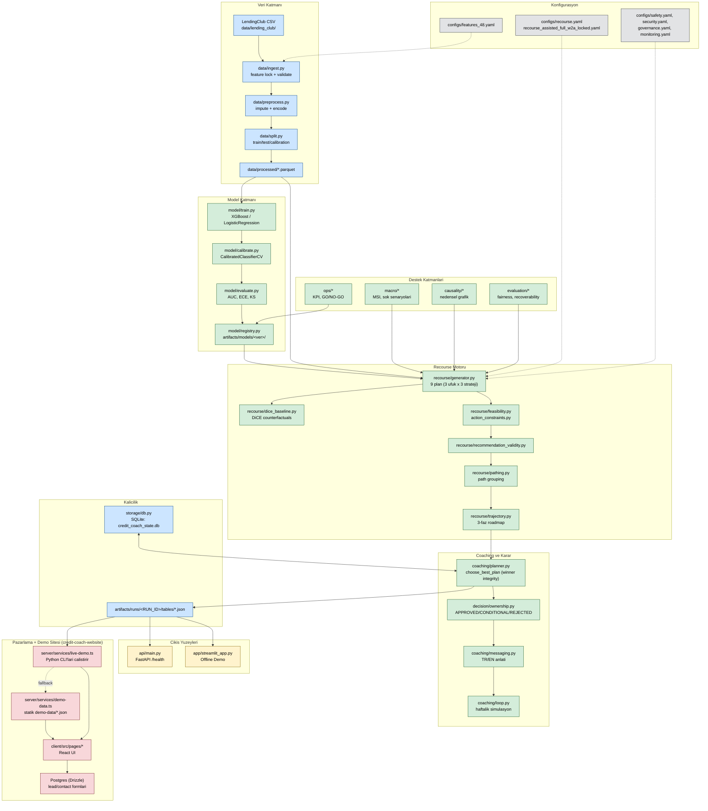

# Credit Coach — Proje Onboarding Rehberi

> Bu doküman, repodaki gerçek kaynak kodu okunarak hazırlanmıştır. Hiçbir davranış varsayılmamış, sadece dosyalarda görülen kod ve dokümanlara dayanılmıştır. Belirsiz kalan noktalar ilgili bölümde açıkça "belirsiz" olarak işaretlenmiştir.

---

## 1. Büyük Resim / Mimari Özet

Credit Coach, bir **kredi riski (PD — Probability of Default / temerrüt olasılığı) modeli** ile bu modelin ürettiği skoru **müşteriye somut, uygulanabilir bir "iyileşme planına" (recourse)** çeviren bir sistemdir. Proje iki ana parçadan oluşur:

1. **`credit-coach/`** — Python tabanlı asıl motor (the engine). Bu, projenin "gerçek" ve tek doğruluk kaynağıdır (single source of truth). İçinde:
   - Veri hazırlama (`data/`)
   - Risk modeli eğitimi/kalibrasyonu (`model/`)
   - **Recourse (iyileşme planı) motoru** (`recourse/`) — sistemin kalbi
   - Haftalık koçluk simülasyonu (`coaching/`)
   - Adil(lik), makro stres, nedensellik, pilot/operasyon katmanları (`evaluation/`, `macro/`, `causality/`, `ops/`, `pilot/`, `retraining/`, `policy/`, `portfolio/`, `decision/`)
   - CLI script'leri (`cli/`) — her iş akışı (`run_*.py`) bağımsız bir Python modülü olarak çalıştırılır
   - Çok ince bir FastAPI (`api/`) ve Streamlit (`app/`) arayüzü

2. **`credit-coach-website/`** — React/Express tabanlı **pazarlama + demo sitesi** ("Kuantitive | Credit Coach"). Bu site, Python motorunu **asla yeniden uygulamaz (re-implement etmez)** — ya `credit-coach/artifacts/` altındaki üretilmiş JSON çıktılarından kürate edilmiş statik kopyaları (`demo-data/*.json`) gösterir, ya da tek müşteri demosu için Python CLI'larını canlı olarak çalıştırır (`server/services/live-demo.ts`).

Bunun dışında **`.planning/`** dizini, projenin GSD (Get-Shit-Done) tabanlı planlama/yol haritası sistemidir — şu an aktif milestone **v2.7 "Coverage Expansion & Action Surface Unlock"**'dur (bkz. Bölüm 7).

### Katmanlar arası ilişki (özet)

```
ham CSV (LendingClub)
   → data/ingest.py + preprocess.py + split.py   → train/test parquet
   → model/train.py + calibrate.py               → kalibre edilmiş PD modeli (artifacts/models/<version>/)
   → recourse/generator.py                       → her müşteri için 9 plan (3 ufuk × 3 strateji)
   → coaching/planner.choose_best_plan           → "kazanan" planın seçimi (winner integrity)
   → coaching/messaging.py + decision/ownership.py → müşteri/operatör için anlatı + nihai karar durumu
   → artifacts/runs/<RUN_ID>/tables/*.json       → çıktılar
   → credit-coach-website                        → statik kopya veya canlı CLI çağrısı ile gösterim
```

Sistem **uçtan uca şunu yapar**: Bir LendingClub kredi başvurusu verisinden başlayarak, müşterinin temerrüt olasılığını tahmin eder; eğer müşteri reddedilmiş veya riskli ise, modelin tekrar "onaylar" diyeceği noktaya ulaşmak için hangi somut aksiyonların (borç ödeme, gelir belgeleme, kurum tarafından sunulan taksitlendirme teklifi vb.) hangi sırayla ve hangi olasılıkla işe yarayacağını hesaplar, bunu 3 fazlı bir yol haritasına (trajectory) döker, adillik/makro stres/nedensellik açısından doğrular ve sonucu hem operatöre (teknik görünüm) hem müşteriye (sadeleştirilmiş anlatı) sunar.

---

## 2. Klasör Yapısı ve Modül Görevleri

> Not: Phase 1 restructure sonrası tez/TÜBİTAK/eski deneysel config gibi proje-dışı materyaller `.out-of-scope/` altına taşındı. Aşağıdaki tablo **aktif (production-relevant)** yapıyı kapsar.

### Kök dizin

| Yol | Görev | Durum |
|---|---|---|
| `credit-coach/` | Python motoru — modelleme, recourse, coaching, evaluation, ops | **aktif** |
| `credit-coach-website/` | React/Express pazarlama + demo sitesi | **aktif** |
| `.planning/` | GSD planlama sistemi (roadmap, fazlar, milestone'lar, mimari notlar) | **aktif** |
| `.agent/`, `.codex/` | Claude Code ve Codex CLI için GSD ajan tooling'i | **aktif tooling** |
| `.out-of-scope/` | Phase 1'de arşivlenen tez, TÜBİTAK, eski deneysel config'ler, planlama notları | **arşiv** |
| `.gitignore` | Kök seviye `.DS_Store`, `*.docx`, `.claude/` ignore kuralları | **aktif** |

### `credit-coach/src/credit_coach/` — Ana Python paketi

| Modül | Görevi |
|---|---|
| `data/` | Ham LendingClub CSV → feature-lock doğrulaması → ön işleme → train/test/calibration split. Tek doğru kaynağı `configs/features_48.yaml`. |
| `model/` | XGBoost (varsayılan) veya LogisticRegression (fallback) ile PD modeli eğitimi, isotonic kalibrasyon, değerlendirme metrikleri (AUC, Gini, ECE, KS), dosya-tabanlı model registry. |
| `recourse/` | **Sistemin kalbi.** Aksiyon uzayı tanımı, plan üretimi (heuristik + DiCE + kurum kuralları), fizibilite/aksiyon kısıtları, teklif (offer) optimizasyonu, öneri geçerliliği ("winner integrity"), 3 fazlı trajectory, path gruplama. |
| `coaching/` | Recourse planını haftalık simülasyona döker, ilerleme sınıflandırması yapar, yeniden planlama (replan) tetikler, müşteri/operatör anlatısı üretir. `planner.py` "kazanan plan" seçim mantığını içerir. |
| `causality/` | Korelasyon tabanlı basit bir nedensellik grafiği (`rex_runner.py`), bu grafiğe göre aksiyon tutarlılığı cezası (`causal_penalty`). |
| `decision/` | `ownership.py` — nihai müşteri kararının (APPROVED/CONDITIONAL/REJECTED/NEEDS_REVIEW) tek doğruluk kaynağı (`DECISION_POLICY_VERSION = "v2.1_phase_40_5"`). |
| `evaluation/` | Plan-seviyesi metrikler, adillik (fairness), kurtarılabilirlik sınıflandırması (`recoverability.py`), kohort kanıt paketleri, off-policy değerlendirme, kalibrasyon/karar tutarlılığı. |
| `macro/` | Makro-ekonomik stres endeksi (MSI), şok senaryoları, güvenilirlik (reliability) değerlendirmesi, drift tespiti. |
| `ops/` | KPI sözleşmeleri, GO/LIMITED-GO/NO-GO yayın kararı, monitoring/telemetry, operatör inceleme paketleri. |
| `pilot/` | Kurum pilot entegrasyonu için sürümlenmiş sözleşmeler (input/package/refresh contract). |
| `policy/` | `engine.py` — basit onay/red kapısı (`pd_score <= tau`), ret durumunda olumsuz işlem (adverse action) bildirimi üretir. |
| `portfolio/` | Portföy seviyesinde ortalama PD azaltım etkisi hesabı. |
| `retraining/` | Şampiyon/iddiacı (champion/challenger) model yeniden eğitim döngüsü, yönetişim kapıları. |
| `storage/` | SQLAlchemy ile SQLite üzerinde kalıcılık (bkz. Bölüm 4). |
| `safety/` | Bootstrap/conformal güven aralığı hesapları, nihai onay doğrulayıcı. |
| `utils/` | Hashing, run-context (config snapshot + run ID üretimi), zaman yardımcıları. |
| `xai/` | SHAP tabanlı global/local açıklanabilirlik (`shap_global.py`, `shap_local.py`). |
| `api/` | Çok ince bir FastAPI — `/health` ve demo amaçlı `/score/demo`; gerçek auth/rate-limit mantığı `auth.py`'de daha gelişmiş. |
| `app/` | Streamlit tabanlı "Offline Demo" — son çalıştırmanın metriklerini ve plan tablosunu gösterir. Üretim arayüzü değil, placeholder. |
| `cli/` | 28 adet `run_*.py` script — her biri bir iş akışını (veri hazırlama, eğitim, recourse üretimi, fairness, monitoring, pilot, vb.) çalıştırır. Detaylar Bölüm 3'te. |

### `credit-coach/` kök seviyesi

| Yol | Görev |
|---|---|
| `configs/` | Aktif YAML konfigürasyonları (Bölüm 6) |
| `configs/experiments/` | Phase 1 sonrası sadece **3 aktif** config kaldı: `recourse_ab_control.yaml`, `recourse_ab_highrisk_tuned.yaml`, `recourse_phaseb_hybrid_v2.yaml` (kodda hard-coded default olarak referans alınıyor) |
| `data/` | Ham/işlenmiş veri, split'ler (gitignore'lu, repo'da takip edilmiyor) |
| `artifacts/` | Model registry + run çıktıları (gitignore'lu, ~3.5GB) |
| `tests/` | Pytest test paketi |
| `docs/` | Pilot ile ilgili sözleşme/rehber dokümanları |
| `credit_coach_state.db`, `credit_coach_demo_state.db` | SQLite veritabanları (gitignore'lu) |

### `credit-coach-website/`

| Yol | Görev |
|---|---|
| `client/src/pages/` | 7 sayfa: Home, Product, Modules, DemoCenter, Proof, Investor, Contact |
| `client/src/data/site-content.ts` | Pazarlama metinlerinin (TR/EN) **statik olarak** koddan tanımlandığı dosya |
| `server/routes.ts` | Express API rotaları (health, demo index/payload, contact/demo/investor formları) |
| `server/services/live-demo.ts` | **Python motoruna canlı köprü** — `credit-coach` CLI'larını shell ile çalıştırır |
| `server/services/demo-data.ts` | Statik `demo-data/*.json` dosyalarını servis eden katalog |
| `shared/schema.ts` | Drizzle/Postgres tablo tanımları (gerçek DB şeması — lead formları için) |
| `shared/demo-schema.ts` | Demo JSON içeriklerinin Zod şemaları (DB değil, içerik sözleşmesi) |
| `demo-data/` | `credit-coach/artifacts/` çıktılarından elle kürate edilmiş 14 JSON/Markdown dosya |

---

## 3. Veri Akışı

Bu bölüm, **bir recourse isteğinin** (örn. `run_recourse.py` veya web sitesindeki "tek müşteri" demosu) entry point'ten çıktıya kadar hangi dosyalardan geçtiğini, hangi sırayla, her adımda neyin dönüştüğünü açıklar.

### 3.1 Veri hazırlama hattı (offline, bir kerelik / periyodik)

1. **Girdi**: Ham LendingClub CSV (`credit-coach/data/lending_club/*.csv`)
2. `credit_coach/data/ingest.py`
   - `load_feature_contract()` → `configs/features_48.yaml`'i okur (47 feature + 1 target, "feature lock")
   - `validate_and_select_columns()` → eksik kolon varsa **hata fırlatır** (`fail_on_missing: true`), fazla kolonları düşürür (`drop_extra_columns: true`)
   - `load_raw_dataset()` → CSV veya Parquet okur
   - `ingest_data()` → minimum 1000 satır kontrolü
3. `credit_coach/data/preprocess.py`
   - `preprocess_dataframe()` → sayısal kolonlarda medyan ile doldurma, kategorik (object) kolonlarda label-encoding; bu dönüşüm bilgisi (`PreprocessArtifacts`) saklanır ki **aynı dönüşüm** sonraki/canlı verilere de uygulanabilsin (`apply_preprocess()`)
4. `credit_coach/data/split.py`
   - `split_dataframe()` → train/test ayrımı (opsiyonel kronolojik "out-of-time" split)
   - `split_train_calibration()` → train'in %20'si kalibrasyon için ayrılır
5. **Çıktı**: `data/processed/{train,test}.parquet`, `data/splits/split_summary.json`

CLI: `python -m credit_coach.cli.run_prepare_data`

### 3.2 Model eğitimi (offline, periyodik — `retraining/` ile otomatikleştirilebilir)

1. `model/train.py` → `train_risk_model()`
   - Backend seçimi: varsayılan **XGBoost** (`tree_method="hist"`, sabit seed, deterministik), `CREDIT_COACH_FORCE_BACKEND` / `CREDIT_COACH_ALLOW_XGB` env değişkenleriyle kontrol edilir. XGBoost başarısız olursa veya kapalıysa **`LogisticRegression(solver="liblinear")`**'a düşer (fallback).
   - `monotone_constraints` desteklenir (feature'lara yön kısıtı koymak için).
2. `model/calibrate.py` → `calibrate_classifier()` → `CalibratedClassifierCV(cv="prefit", method="isotonic")` ile PD'leri kalibre eder.
3. `model/evaluate.py` → AUC, Gini, PR-AUC, F1, Brier, ECE (10-bin), KS istatistiği hesaplanır.
4. `model/registry.py` → `save_model_bundle()` → `artifacts/models/<model_version>/{model.joblib, calibrator.joblib, metrics.json, manifest.json}` + kök seviyede `latest.json` işaretçisi. `build_frozen_model_manifest()` config/şema/artifact'ların SHA-256 hash'lerini içeren denetlenebilir bir manifest üretir (champion/challenger karşılaştırmaları için).

CLI: `python -m credit_coach.cli.run_train`

### 3.3 Recourse (iyileşme planı) üretimi — bir müşteri için ana akış

Bu, sistemin **en kritik** akışıdır (`recourse/generator.py` etrafında).

1. **Girdi**: `CustomerSnapshot` (x_t — 48 feature'lık müşteri anlık görüntüsü) + `MacroSnapshot` (z_t — makro ekonomik durum) — şemaları `data/schema.py`'de tanımlı (Pydantic v2, ~1800 satır, projenin **kanonik veri sözleşmesi**).
2. `model/predict.py` → `predict_proba_pd()` ile mevcut PD hesaplanır; `apply_threshold()` ile `tau` eşiğine göre onay/red belirlenir (PD ≤ tau ⇒ onay).
3. `recourse/generator.py`:
   - **3 ufuk** (3/6/12 ay) × **3 strateji** (conservative/balanced/aggressive) = **9 plan** üretilir.
   - Her plan için 3 "lane" (aday üretim kaynağı) çalıştırılır:
     - **İçsel heuristik** üretici (`_build_actions`)
     - **DiCE** (Diverse Counterfactual Explanations, `dice-ml` paketi) — `recourse/dice_baseline.py`. Native DiCE başarısız olursa `_heuristic_actions` fallback'i devreye girer; bu durum `PlanAction.dice_backend_class` alanında (`native` / `heuristic_fallback` / `skipped`) izlenir.
     - **Kurum kuralları** (`recourse/institution_rules.py`) — gecikme/borç sinyallerine göre kurumsal aksiyonlar (taksitlendirme, vb.)
   - `recourse/feasibility.py` → her aksiyonun ne kadar değişebileceğine dair fizibilite klipleme (behavioral %5, structural %35, institutional %50 gibi semantik oran limitleri).
   - `recourse/action_constraints.py` → `enforce_action_constraints()` → her aksiyonu `valid`/`repaired`/`provisional`/`invalid` olarak işaretler, çakışan kısıtları öncelik sırasına göre çözer.
   - `recourse/execution_probability.py` → her aksiyonun gerçek hayatta yürütülme olasılığı (müşteri kontrolünde mi, kurum onayına bağlı mı) hesaplanır.
   - `recourse/offer_optimization.py` → kurum tarafı aksiyonlar için `OfferContract`/`OfferTerms` (ödeme indirimi, vade uzatımı, faiz değişimi vb.) ve `OfferFeasibility` (`active_rankable` vb.) üretilir.
   - Plan, kalibre model üzerinden **yeniden skorlanır** (`predict_proba_pd`) — "bu aksiyonları uygularsan PD'n ne olur?"
   - `recourse/recommendation_validity.py` → `annotate_action_recommendation_validity` / `annotate_plan_recommendation_validity` — örn. "DTI'nı artır" gibi anlamsız bir öneri varsa `invalid` işaretlenir (`RecommendationValidityStatus`).
   - `causality/action_constraints.py` → `causal_penalty` — nedensel grafiğe göre tutarsız aksiyon kombinasyonlarına ceza puanı.
   - `macro/reliability.py` → makro şok senaryoları altında planın dayanıklılığı (`compute_robust_anchor_pd`, `evaluate_reliability_from_pd`).
   - `safety/statistical.py` → `estimate_prediction_ci` — PD tahmini için güven aralığı.
   - `recourse/trajectory.py` → `attach_canonical_trajectory` — 3 fazlı yol haritası: `phase_1_stabilize` (1-4. hafta, hedefin %45'i), `phase_2_build` (5-12. hafta, %75), `phase_3_optimize` (13-24. hafta, %100); 4/12/24. haftalarda checkpoint'ler.
4. `recourse/pathing.py` → 9 plan, `path_type`'a göre gruplanır (`customer_only` / `institution_assisted` / `hybrid`); her grup için en iyi temsilci (`_choose_representative`) seçilir; `path_action_diversity_index` ile aksiyon çeşitliliği ölçülür.
5. `coaching/planner.py` → `choose_best_plan()` — **"kazanan" plan seçimi (winner integrity)**:
   - Geçersiz (invalid) planlar `filter_invalid_numeric_plans` ile elenir.
   - Durum önceliği (APPROVED < NEEDS_REVIEW < REJECTED < ERROR), kısıt önceliği (valid < repaired < provisional < invalid), kaynak önceliği (internal < dice < rule < fallback), readiness bonusu (high=+0.08, moderate=+0.03, low=-0.08) gibi kriterlerle sıralanır.
   - `selection_outcome` (`selected_valid_winner` | `no_valid_winner`) ve `selection_stage` (kademeli "genişletme" — `preferred_valid` → ... → `no_valid_winner`) ile **hangi gevşetme seviyesinde** bir kazanan bulunduğu izlenir.
6. `decision/ownership.py` → nihai müşteri kararı (`APPROVED`/`CONDITIONAL`/`REJECTED`/`NEEDS_REVIEW`) ve teklif olgunluğu (offer maturity) belirlenir.
7. `coaching/messaging.py` → müşteri için TR/EN anlatı (`CustomerRoadmapNarrative`), reddedilme nedenleri için "adverse action" metni (`_ADVERSE_ACTION_REASON_MAP` — örn. `dti` → "high_debt_to_income").
8. **Çıktı**: `PlanRecord`, `RecoursePathRecord`, `OperatorReviewPacket` nesneleri → `artifacts/runs/<RUN_ID>/tables/{customer_roadmap.json, plans.json}`, `metrics.json`, `config_snapshot.yaml`.

CLI: `python -m credit_coach.cli.run_recourse`

### 3.4 Haftalık koçluk simülasyonu (opsiyonel, batch)

`coaching/loop.py` → `run_weekly_coaching_loop()`:
- Plan aksiyonlarını hafta hafta uygular (`_planned_actions_this_week` ile haftalık aksiyon sayısı sınırlanır).
- Belirli bir haftada makro şok enjekte edilebilir (`macro_shock_week`).
- Yürütme gürültüsü/atlama (`action_dropout_prob`, `execution_noise_std`) eklenir.
- Her hafta `coaching/progress.py` → `classify_progress()` ile ilerleme `improving`/`stagnant`/`deteriorating` olarak sınıflandırılır.
- `coaching/reviewer.py` → `evaluate_replan()` — kötüleşme, CI ihlali veya kaçırılan aksiyon serisi varsa yeniden planlama tetiklenir.

CLI: `python -m credit_coach.cli.run_coaching`

### 3.5 Web sitesi tarafından "tek müşteri" canlı demosu

`credit-coach-website/server/services/live-demo.ts`:
1. İstek `GET /api/demo/single-customer-roadmap` (veya `-limited`) rotasına gelir.
2. `getDemoPayload()` önce `getLiveSingleCustomerDemo()`'yu dener:
   - `creditCoachRootDir()` ile **kardeş dizindeki** `../credit-coach` Python reposu bulunur.
   - `runPythonCommand()` → `execFile` ile `python`/`python3`, `cwd=credit-coach`, `DB_URL=sqlite:///./credit_coach_demo_state.db`, `PYTHONPATH=credit-coach/src` ortam değişkenleriyle çalıştırılır.
   - Gerekirse önce `run_prepare_data` ve `run_train` (config: `configs/website_demo.yaml`) çalıştırılır (`ensureWebsiteDemoAssets()`).
   - Ardından belirli bir müşteri/satır için `run_recourse` çalıştırılır.
   - Sonuç, `artifacts/runs/<RUN_ID>/tables/{customer_roadmap.json, plans.json}` ve `metrics.json`'dan okunur, `SingleCustomerDemo` şekline normalize edilir ve Zod ile doğrulanır.
   - Sonuçlar 15 dakika bellek-içi cache'lenir.
3. **Hata durumunda fallback**: Python çağrısı başarısız olursa veya repo bulunamazsa, `demo-data/single_customer_roadmap.json` statik dosyası servis edilir.
4. Diğer tüm demo slug'ları (`portfolio-batch-summary`, `offer-optimization`, vb.) **her zaman** `demo-data/*.json` statik dosyalarından okunur — canlı Python çağrısı yapılmaz.

---

## 4. Veritabanı Şeması ve İlişkiler

Projede **iki ayrı veritabanı dünyası** var: Python motorunun SQLite veritabanı ve web sitesinin (opsiyonel) Postgres veritabanı.

### 4.1 Python motoru — SQLite (`credit_coach_state.db`, `credit_coach_demo_state.db`)

- Bağlantı: `src/credit_coach/storage/db.py:53` — `DB_URL` env değişkeni, varsayılan `sqlite:///./credit_coach_state.db`. WAL modu ve foreign key desteği açık.
- Şema migrasyon aracı **yok** — tablolar `Base.metadata.create_all()` ile oluşturuluyor (yani şema değişikliği = manuel/elle yönetilen risk, bkz. Bölüm 10).
- `src/credit_coach/storage/models.py`'de tanımlı ORM tabloları:

| Tablo | ORM sınıfı | İçerik |
|---|---|---|
| `customer_snapshots` | `CustomerSnapshotORM` | Müşterinin 48-feature anlık görüntüsü (x_t) |
| `macro_snapshots` | `MacroSnapshotORM` | Makro ekonomik anlık görüntü (z_t) |
| `plan_records` | `PlanRecordORM` | Üretilen recourse planları (~80 alan: offer, trajectory, validity, execution probability, movement skorları) |
| `model_runs` | `ModelRunORM` | Model eğitim çalışmalarının meta verisi |
| `decision_outcomes` | `DecisionOutcomeORM` | Gerçekleşen karar sonuçları |
| `decision_outcome_contexts` | `DecisionOutcomeContextORM` | Karar sonucu bağlamı |
| `decision_outcome_realization_contexts` | `DecisionOutcomeRealizationContextORM` | Sonucun gerçekleşme bağlamı |
| `decision_action_execution_events` | `DecisionActionExecutionEventORM` | Aksiyonların yürütülme olayları |
| `audit_events` | `AuditEventORM` | **Hash-zincirli, değiştirilemez** denetim kaydı (immutable audit trail) |

`credit_coach_demo_state.db` kodda doğrudan referans edilmiyor — `configs/website_demo.yaml` ve `live-demo.ts` üzerinden `DB_URL` ile işaret edilen, demo amaçlı ayrı bir SQLite dosyası olarak kullanılıyor (aynı şema).

> **Önemli**: Bu iki `.db` dosyası `.gitignore`'da ve repoda takip edilmiyor — Phase 1 restructure'da **dokunulmadı**.

### 4.2 Website — Postgres (Drizzle ORM, `shared/schema.ts`)

Sadece **`DATABASE_URL`** env değişkeni set edilirse aktif olur (`server/db.ts:6` — `pool = connectionString ? new Pool(...) : null`). Set edilmezse form gönderimleri bellek-içi diziye (`memoryStore`) düşer ve `mode: "memory"` döner — yani **veritabanı olmadan da site çalışır**, sadece kalıcılık yoktur.

| Tablo | Alanlar (özet) |
|---|---|
| `contact_requests` | id, name, company, role, email, message, createdAt |
| `demo_requests` | yukarıdakilere ek: useCase, teamSize, institutionType, portfolioFocus, demoTrack, timeline, dataReadiness |
| `investor_requests` | yukarıdakilere ek: fundName, focusArea |
| `demo_snapshots` | id, slug, title, category, sourceRunId, sourceArtifact — **şu an kullanılmıyor**, V2 kapsamı için tanımlı |

Bu Postgres şeması, **Python motorunun çıktılarını asla saklamaz** — sadece web sitesi üzerinden gelen lead/iletişim formlarını saklar. `TECH_ARCHITECTURE.md`'de açıkça belirtilen kural: "engine output never goes into Postgres."

---

## 5. Dış Servis Entegrasyonları

| Entegrasyon | Nasıl çağrılır | Hata durumu / fallback |
|---|---|---|
| **DiCE (`dice-ml`)** | `recourse/dice_baseline.py` içinde `_DiceRuntime` — model+kalibratörü DiCE'ın `predict_proba` arayüzüne uyarlayan `_ModelProxy`. Yöntemler: `random`, `genetic`, `kdtree` (`_ALLOWED_DICE_METHODS`). | Native DiCE hata verirse veya kapalıysa `_heuristic_actions` fallback'ine düşer; bu `PlanAction.dice_backend_class` alanında (`native`/`heuristic_fallback`/`skipped`) kayda geçer. |
| **XGBoost** | `model/train.py` — varsayılan model backend'i, `n_jobs=1`, `tree_method="hist"`, sabit seed. | `CREDIT_COACH_ALLOW_XGB=0` veya hata durumunda `LogisticRegression(solver="liblinear")`'a düşer; backend bilgisi model nesnesine (`_credit_coach_backend`) yazılır. |
| **SHAP** | `xai/shap_global.py`, `xai/shap_local.py` — global/lokal açıklanabilirlik, `data/schema.py`'deki `LocalReason`/`ExplainabilityMeta` alanlarını besler. | Belirsiz — kod okunmadı, ayrı bir derinlemesine inceleme gerekir. |
| **Telemetry export (Prometheus/OTLP/file)** | `ops/telemetry.py`, config: `configs/monitoring.yaml` — varsayılan **kapalı**. | Auth katmanı yok (bkz. Bölüm 10, güvenlik riski). |
| **Web sitesi → Python motoru köprüsü** | `credit-coach-website/server/services/live-demo.ts` — `execFile` ile `python`/`python3` çağırır, `cwd=../credit-coach`, `PYTHONPATH=credit-coach/src`. Sadece "tek müşteri roadmap" demosu için. | Python çağrısı/repo bulunamazsa `demo-data/single_customer_roadmap.json` statik dosyasına düşer. 15 dakikalık in-memory cache var. |
| **Web sitesi → Postgres** | `server/db.ts` — `DATABASE_URL` varsa Drizzle/`pg.Pool`. | `DATABASE_URL` yoksa `databaseAvailable=false`, form verileri bellekte (`memoryStore`) tutulur, `mode: "memory"` döner. |
| **Web sitesi → harici LLM/AI servisi** | **Yok.** Kod tabanında herhangi bir LLM API çağrısı (OpenAI, Anthropic, vb.) tespit edilmedi. | — |

Projede **CI/CD, Docker, harici bulut servisi entegrasyonu bulunmuyor** — bu tamamen yerel (local-first) bir araştırma/prototip kod tabanı.

---

## 6. Konfigürasyon, Environment ve Deploy Yapısı

### 6.1 Python motoru (`credit-coach/`)

**Kurulum** (`credit-coach/README.md`):
```bash
cd credit-coach
python -m venv .venv
source .venv/bin/activate
pip install -e ".[dev]"
cp .env.example .env
```

- Paket yöneticisi: pip + setuptools (legacy backend), `pyproject.toml` üzerinden editable install. `uv.lock` dosyası mevcut ama README pip akışını gösteriyor — **belirsiz**: uv mu pip mi kanonik, ikisi de repoda var.
- Python ≥ 3.11 gerekli.
- `[project.scripts]` **tanımlı değil** — tüm CLI'lar `python -m credit_coach.cli.run_<isim>` şeklinde modül olarak çalıştırılır.
- `.env.example` → `DB_URL=sqlite:///./credit_coach_state.db`, `ARTIFACT_DIR=./artifacts`, `LOG_LEVEL=INFO`, yorum satırında gelecekteki Postgres bağlantısı için yer tutucu.
- Test: `pytest` (`testpaths=["tests"]`, `addopts="-v --tb=short"`).
- **Docker/Makefile/CI yok** — repo genelinde arama yapıldı, hiçbiri bulunamadı.

#### Aktif config dosyaları (`credit-coach/configs/`)

| Dosya | Ne yapılandırır |
|---|---|
| `default.yaml` | Temel pipeline — veri/split/artifact yolları, logging, `database.url`, `features_48.yaml` işaretçisi |
| `model.yaml` | XGBoost hiperparametreleri (500 estimator, depth 6, lr 0.05, `scale_pos_weight: 3.0`), kalibrasyon backend ayarları |
| `recourse.yaml` | Recourse üretiminin ana config'i — planlama ufukları, stratejiler, SHAP kararlılığı, DiCE yöntem/fallback, aksiyon bütçeleri, robust/CVaR hedefleri |
| `recourse_assisted_full_w2a_locked.yaml` | **W2a baseline**'ına kilitlenmiş "assisted_full" recourse eşik/config snapshot'ı |
| `recourse_feasibility.yaml` | Feature başına aylık maksimum değişim sözleşmesi (örn. `loan_amnt` max %30 relatif değişim) |
| `safety.yaml` | Bootstrap/conformal güven aralığı — B=500, normal/yüksek-stres alpha eşikleri |
| `security.yaml` | API auth — bearer token politikası, endpoint scope'ları, rate limit, `allow_insecure_local_demo` |
| `governance.yaml` | Model yayın eşikleri — min AUC 0.75, max ECE 0.05, max fairness gap 0.10, PSI eşiği 0.20 |
| `monitoring.yaml` | PSI drift eşikleri (warn 0.10/fail 0.20), telemetry export (varsayılan kapalı) |
| `retraining.yaml` | Haftalık champion/challenger retraining (Pazartesi 02:00 UTC), 12 aylık veri penceresi, min 5000 örnek |
| `macro.yaml` | Makro Stres Endeksi (MSI) — 5 makro feature ve ağırlıkları |
| `causality.yaml` | Nedensel grafik (ReX/PC algoritması) parametreleri |
| `coaching.yaml` | Haftalık koçluk döngüsü — ilerleme eşikleri, max 3 haftalık aksiyon, %15 aksiyon kaçırma olasılığı |
| `kpi_contract.yaml` | Üretim smoke testi KPI eşikleri — latency p95 500ms/p99 2000ms, max hata oranı, fairness gap |
| `features_48.yaml` | **48 kolonluk feature lock** — projenin tek doğruluk kaynağı |
| `lendingclub_full.yaml` | Phase 70 için büyük veri seti varyantı (`default.yaml`'ın ayrı path'lerle kopyası, model/threshold değişikliği yok) |
| `model_website_demo.yaml` | Web demo için hafif model config'i — `logistic_regression`, `allow_xgboost: false` |
| `website_demo.yaml` | Web demo için izole config — `data/sample/lending_club_sample_2000.csv`, ayrı processed/splits dizinleri |
| `institution_offer.example.yaml` | Örnek kurum teklif (offer) yapılandırması |
| `institution_policy.example.yaml` | Örnek kurum politikası — kadans, izinli kohort politikaları, ifade kısıtları |
| `pilot_profile.example.yaml` | Örnek pilot kohort seçim profili |
| `configs/experiments/recourse_ab_control.yaml`, `recourse_ab_highrisk_tuned.yaml` | `run_high_risk_ab.py`'nin varsayılan kontrol/tedavi config'leri |
| `configs/experiments/recourse_phaseb_hybrid_v2.yaml` | `run_model_challenger_matrix.py` ve `run_phase_experiment_suite.py`'nin varsayılan config'i |

### 6.2 Web sitesi (`credit-coach-website/`)

- **Tech stack**: React 18.3 + Vite 5.4 + TypeScript 5.8, Express 5.1, Drizzle ORM 0.43 + `pg` (Postgres), `wouter` (routing), `@tanstack/react-query`, `react-hook-form` + `zod`.
- **npm scriptleri**:
  - `dev`: `NODE_ENV=development tsx server/index.ts` (Vite middleware modunda)
  - `build`: `vite build` + esbuild ile server bundle (`dist/server/index.js`)
  - `start`: `NODE_ENV=production node dist/server/index.js`
  - `check`: TypeScript type-check
  - `db:push`: `drizzle-kit push` (Postgres şema senkronizasyonu)
- **Environment değişkenleri** (`.env` dosyası repoda yok, dışarıdan sağlanmalı):
  - `DATABASE_URL` — Postgres bağlantısı (opsiyonel, yoksa memory-mode)
  - `NODE_ENV` — dev/production
  - `PORT` — varsayılan 3000
  - `PYTHONPATH` — `live-demo.ts` tarafından `credit-coach/src` eklenir
  - **Örtük bağımlılık**: `../credit-coach` adında bir kardeş Python reposu + `python`/`python3` PATH'te olmalı (canlı demo için)
- **Docker/CI yok.**

### 6.3 Projeyi yerelde çalıştırmak için gereken minimum adımlar

1. `credit-coach/`: venv oluştur, `pip install -e ".[dev]"`, `.env.example`'ı `.env`'e kopyala.
2. Veri hazırla: `python -m credit_coach.cli.run_convert_raw_data` (CSV→Parquet), `python -m credit_coach.cli.run_prepare_data`.
3. Model eğit: `python -m credit_coach.cli.run_train`.
4. Recourse üret: `python -m credit_coach.cli.run_recourse`.
5. (Opsiyonel) `credit-coach-website/`: `npm install`, `npm run dev` — `credit-coach` kardeş dizini varsa canlı demo çalışır, yoksa statik `demo-data/` kullanılır.

---

## 7. Versiyon ve Dosya İsimlendirme Karmaşası

Proje, **"phase" tabanlı** artımlı geliştirme geçmişine sahip (Phase 39 → 70+, milestone'lar v1.0 → v2.7). Bu, dosya isimlerinde ve config'lerde sürüm numaralarının iz bırakmasına yol açmış.

### 7.1 Phase 1'de arşivlenenler (artık `.out-of-scope/configs_experiments/`'te)

- **92 dosya** — bunların **70'i** `tmp_*` ön ekli deneysel sweep config'leri (örn. `tmp_quota40_fair_w250.yaml`, `tmp_final_q30_tb700.yaml`), **22'si** sadece arşivlenmiş/legacy planlama dokümanlarında referans edilen veya hiç referans edilmeyen isimli config'ler (örn. `recourse_ab_highrisk_tuned_v2.yaml`...`v5.yaml`, `recourse_phaseb_hybrid_v1.yaml`, `safety_reliability_blend_v1.yaml`).
- Bu dosyalar artık **hiçbir aktif kod yolunda kullanılmıyor** — `.planning/phases/` ve `.planning/milestones/` içinde sıfır referans bulundu.

### 7.2 Production'da gerçekten çalışan / aktif olan versiyonlu dosyalar

Bunlar **"legacy cruft" değil, halen yük taşıyan (load-bearing) kod yollarıdır** — silinmemeli:

| Dosya/İsim | Neden hâlâ aktif |
|---|---|
| `configs/experiments/recourse_phaseb_hybrid_v2.yaml` | `cli/run_model_challenger_matrix.py:291` ve `cli/run_phase_experiment_suite.py:51`'in **varsayılan** `--recourse_config` değeri |
| `configs/experiments/recourse_ab_control.yaml`, `recourse_ab_highrisk_tuned.yaml` | `cli/run_high_risk_ab.py:28-29`'un varsayılan kontrol/tedavi config'leri |
| `cli/run_v24_cohort_evaluation.py`, `cli/rescue_v24_cohort_aggregation.py` | v2.4 milestone'undan kalan ama hâlâ kullanılan kohort değerlendirme modülleri; `rescue_*` dosyası, ana modülün çıktısını yeniden birleştirmek için "rescue" amaçlı bir sarmalayıcı |
| `cli/run_v25_phase69_evidence_amplification.py` | `run_v24_cohort_evaluation`'ı doğrudan import ediyor — v2.5 modülü v2.4 üzerine inşa edilmiş |
| `evaluation/decision_calibration.py` | İçinde `_v2_3a`/`_v2_3b` son ekli hard-coded `policy_version` string'leri var (örn. `analysis_mild_relax_v2_3a`, `trust_first_baseline_v2_3`) — bu **runtime'da kullanılan profil kimlikleridir**, dosya adı değil ama aynı kafa karışıklığı kalıbı |

### 7.3 "Hangisi production'da çalışıyor?" — net cevap

- **Model**: `artifacts/models/<model_version>/latest.json` işaretçisinin gösterdiği bundle; `model/registry.py`'deki `resolve_model_manifest()` üç çözümleme modunu destekler — explicit manifest, explicit model_version, veya implicit "latest" (sadece ilk ikisi `acceptance_eligible`).
- **Recourse config**: Varsayılan akış `configs/recourse.yaml`'ı kullanır; **W2a baseline** için kilitlenmiş hali `configs/recourse_assisted_full_w2a_locked.yaml`'dır (v2.6/v2.7 kohort kanıtlarının referans noktası).
- **Web demo**: `configs/website_demo.yaml` + `configs/model_website_demo.yaml` — ayrı, izole bir veri/model seti kullanır, ana production akışıyla **karışmaz**.

---

## 8. Test Geçmişi ve Bilinen Sorunlar

> Bu bölüm `.planning/codebase/CONCERNS.md` ve `.planning/codebase/TESTING.md`'den derlenmiştir.

### 8.1 Test altyapısı

- Tüm testler `credit-coach/tests/` altında, pytest ile çalıştırılır.
- `conftest.py` fixture'ları (`feature_list_48`, `temp_db_url` vb.) ortak test verisi sağlıyor.
- Env değişkenleri ve config'ler için yoğun `monkeypatch` kullanımı var.
- Resmi bir coverage eşiği **yok**.
- KPI/smoke testleri DataFrame tabanlı assertion'lar kullanıyor.

### 8.2 Bilinen sorunlar / teknik borç (CONCERNS.md'den)

1. **`run_batch_recourse_eval.py` çok büyük** (>4.300 satır) — değişiklik riski yüksek, bölünmesi gerekiyor.
2. **`configs/experiments/` config sprawl** — Phase 1'de büyük ölçüde temizlendi (92 dosya arşivlendi), ancak hangi varyantın "otoriter" olduğu konusu geçmişte belirsizdi.
3. **Şema migrasyon framework'ü yok** — Pydantic sözleşmeleri (`data/schema.py`) ve SQLAlchemy ORM modelleri (`storage/models.py`) zamanla **birbirinden sapabilir** (drift riski).
4. **GSD yardımcı tooling'i kırık**: `node ./.codex/get-shit-done/bin/gsd-tools.cjs init map-codebase` → `Cannot find module './lib/core.cjs'` hatası veriyor.
5. **Güvenlik riski**: `CREDIT_COACH_ALLOW_INSECURE_API=1` env değişkeni, auth'u tamamen bypass eder — sadece local demo için tasarlanmış ama production'da yanlışlıkla set edilirse büyük risk.
6. **Telemetry export'ta auth katmanı yok.**
7. **Performans darboğazları**: Batch recourse evaluation ve DiCE aday üretimi — p95/p99 latency tekrar tekrar yayın engelleyici (release blocker) olarak işaretlenmiş.
8. **Test kapsam boşlukları**: Streamlit demo yolu test edilmiyor; şema evrimi/migrasyon testi yok (yüksek öncelikli boşluk olarak işaretli).

### 8.3 Proje evrimi (v1.0 → v2.7) — kısa kronoloji

| Versiyon | Tarih | Odak |
|---|---|---|
| v1.0 Brownfield Baseline | 2026-03-10 | Deterministik eğitim, recourse üretimi, benchmark, telemetry, audit, smoke kapıları |
| v1.1 Fairness Stability & KPI Hardening | 2026-03-15 | GO/LIMITED_GO/NO_GO fairness semantiği, birleşik KPI sözleşmeleri |
| v1.2 Recommendation Quality Hardening | 2026-03-16 | Tipize edilmiş aksiyonlar, execution-aware sıralama, IPS/Doubly-Robust off-policy değerlendirme |
| v1.3 Portfolio Intelligence & Productization | 2026-03-20 | Portföy seviyesi kanıt, Demo Center/Proof/Investor yüzeyleri |
| v2.0 Personalized Action & Decision Intelligence | 2026-03-22 | Deterministik semantik aksiyonlar, müşteriye özel numerik hedefler, kurum-teklif sözleşmeleri |
| v2.1 Decision Ownership & Pilot-Ready Trust | 2026-03-23 | Tek deterministik karar sahibi (APPROVED/CONDITIONAL/REJECTED), operatör paketleri |
| v2.2 Winner Integrity & Consumer Consistency | 2026-04-02 | `choose_best_plan()`'daki geçersiz-kazanan sızıntısı düzeltildi, DICE lane geçerliliği |
| v2.3 Threshold & Outcome Optimization | 2026-04-03 | 44 faz — fairness sözleşmeleri, finansal gerçekçilik, sıralı trajectory planlama |
| v2.5 Recoverable Customer Targeting | (aktif, MILESTONES.md'de) | Kurtarılabilirlik sınıflandırıcısı, hareket-odaklı sıralama |
| v2.6 Real Cohort Evidence & Realization Proof | 2026-04-11 (Phase 68) | Gerçek kohort yeniden çalıştırmalarında güven sözleşmesinin tutarlılığının kanıtlanması — **"W2a" baseline'ı bu milestone'dan** |
| **v2.7 Coverage Expansion & Action Surface Unlock** (aktif) | — | Aksiyon kapsamını ~%3'ten %10-20'ye çıkarmak, "%97 empty-state limited mode" sorununu çözmek, güven sayaçlarını bozmadan çok-aksiyonlu planları yüzeye çıkarmak |

> Not: `.planning/MILESTONES.md` ile `.planning/STATE.md` arasında küçük bir tutarsızlık var — MILESTONES.md v2.5'i "aktif" gibi gösterirken STATE.md v2.7'nin aktif olduğunu söylüyor. STATE.md daha güncel kabul edilmeli.

---

## 9. Teknoloji Sözlüğü

| Teknoloji | Ne | Bu projede neden seçildi (gerekçe) |
|---|---|---|
| **Python 3.11+** | Programlama dili | Veri bilimi/ML ekosisteminin (pandas, scikit-learn, xgboost) doğal dili; tüm motor bunun üzerine kurulu |
| **XGBoost** | Gradient boosting kütüphanesi | PD modelinin varsayılan backend'i — `tree_method="hist"` ve sabit seed ile **deterministik** sonuç garantisi önemli (denetlenebilirlik/reprodüksiyon için) |
| **scikit-learn (`LogisticRegression`, `CalibratedClassifierCV`)** | ML araç seti | XGBoost'a **fallback** backend + isotonic kalibrasyon için `CalibratedClassifierCV(cv="prefit")` |
| **DiCE (`dice-ml`)** | Diverse Counterfactual Explanations | "Bu müşteri için modeli onaya çevirecek minimal feature değişikliği nedir?" sorusunun cevabını üretmek — recourse planlarının bir "lane"i; native başarısız olursa heuristic fallback var |
| **SHAP** | Açıklanabilirlik kütüphanesi | Global/lokal feature önem analizleri (`xai/shap_global.py`, `xai/shap_local.py`) — modelin kararlarını açıklamak |
| **Pydantic v2** | Veri doğrulama/şema | `data/schema.py` — projenin **kanonik veri sözleşmesi** (CustomerSnapshot, PlanRecord, vb.), ~1800 satır, Türkçe açıklamalı |
| **SQLAlchemy 2.0 + SQLite** | ORM + veritabanı | Hafif, dosya-tabanlı kalıcılık — plan kayıtları, karar sonuçları, hash-zincirli audit log (`storage/`) |
| **PyArrow + Parquet** | Kolon-tabanlı dosya formatı | İşlenmiş train/test verisi CSV yerine Parquet olarak saklanıyor — daha hızlı IO |
| **Streamlit** | Hızlı veri uygulaması arayüzü | `app/streamlit_app.py` — "Offline Demo", son run'ın metrik/plan tablosunu gösteren placeholder arayüz |
| **FastAPI** | Web API framework | `api/main.py` — çok ince, sadece `/health` ve demo `/score/demo`; asıl auth/rate-limit mantığı `api/auth.py`'de |
| **uv / pip + setuptools** | Python paket yönetimi | `uv.lock` ve `pyproject.toml` ikisi de mevcut — README pip akışını gösteriyor, hangisi kanonik **belirsiz** |
| **React 18 + Vite + TypeScript** | Frontend framework/build tool | `credit-coach-website/client` — modern, hızlı geliştirme deneyimi için |
| **Express 5** | Node.js web sunucu framework'ü | `credit-coach-website/server` — statik dosya servis + API rotaları + Vite middleware (dev) |
| **Drizzle ORM + Postgres** | ORM + veritabanı | Web sitesinin lead/iletişim formları için — **opsiyonel**, `DATABASE_URL` yoksa memory-mode'a düşer |
| **Zod** | Şema doğrulama (TS) | `shared/demo-schema.ts`, `shared/content-schema.ts` — demo JSON içerikleri ve form girdileri için tip-güvenli doğrulama |
| **wouter** | React routing | Hafif bir router — sadece 7 sayfa olduğu için ağır bir çözüm (react-router) yerine seçilmiş olabilir (**belirsiz**, gerekçe kodda yazılı değil) |
| **@tanstack/react-query** | Veri getirme/cache | `useDemoData.ts` — demo API çağrılarının cache'lenmesi |
| **GSD (Get-Shit-Done)** | Planlama/ajan framework'ü | `.planning/`, `.agent/`, `.codex/` — fazlı geliştirme, milestone takibi, AI ajan tabanlı iş akışı yönetimi için |

---

## 10. Eksiklikler / İyileştirme Alanları

Bölüm 8.2'deki teknik borç listesine ek olarak, mimari okumadan çıkan gözlemler:

1. **Şema/ORM senkron riski** — `data/schema.py` (Pydantic) ile `storage/models.py` (SQLAlchemy ORM) arasında otomatik bir tutarlılık kontrolü yok; migrasyon framework'ü eklenmesi (Alembic vb.) ileride şart olacak.
2. **`run_batch_recourse_eval.py`'nin (>4.300 satır) bölünmesi** — bu dosya hem değişiklik riski hem de okunabilirlik açısından öncelikli bir refactor adayı.
3. **Güvenlik**: `CREDIT_COACH_ALLOW_INSECURE_API` env değişkeninin production ortamlarında kesinlikle set edilmediğinden emin olunmalı; telemetry export endpoint'lerine auth eklenmeli.
4. **Paket yönetimi belirsizliği** (`uv.lock` vs `pip install -e`) — hangisinin kanonik olduğu netleştirilmeli, README güncellenmeli.
5. **GSD tooling kırıklığı** (`gsd-tools.cjs` → `core.cjs` bulunamıyor) — `.codex/get-shit-done/` kurulumunun onarılması, planlama otomasyonunun (`$gsd-plan-phase` gibi komutlar) güvenilirliği için önemli.
6. **Web sitesi `scripts/sync-demo-artifacts.ts` bir placeholder/no-op** — `demo-data/*.json` dosyaları elle güncelleniyor; bu otomasyonun tamamlanması, web sitesindeki demo verilerinin Python motorunun en güncel kohort kanıtlarıyla **manuel senkron tutulması riskini** azaltır.
7. **v2.7 odağı** (STATE.md'den): Aksiyon kapsamı şu an **~%3** — müşterilerin büyük çoğunluğu (~%97) "empty-state limited mode"a düşüyor. Bu, hem ürün hem de mühendislik açısından en büyük açık öncelik (Phase 71-77 kuyruğu bunu hedefliyor).
8. **Streamlit demo path'i test edilmiyor** — `app/streamlit_app.py` ve `app/state.py`'deki `DashboardState` placeholder görünüyor; gerçek bir operatör arayüzü olarak geliştirilecekse önce test kapsamı eklenmeli.
9. **MILESTONES.md / STATE.md tutarsızlığı** (Bölüm 8.3) — planlama dokümanlarının senkronizasyonu için küçük ama kafa karıştırıcı bir tutarsızlık, düzeltilmeli.

---

## 11. Stajyer için İlk Hafta Checklist'i

### Kurulum (Gün 1)
- [ ] `credit-coach/` için Python 3.11+ venv kur, `pip install -e ".[dev]"` çalıştır.
- [ ] `.env.example` → `.env` kopyala, `DB_URL`/`ARTIFACT_DIR`/`LOG_LEVEL` değerlerini gözden geçir.
- [ ] `pytest` çalıştırarak mevcut test paketinin geçtiğini doğrula.
- [ ] (Opsiyonel) `credit-coach-website/` için `npm install`, `npm run dev` — `credit-coach` kardeş dizini olduğundan canlı demo bağlantısının çalıştığını gör (veya statik fallback'i gözlemle).

### Önce okunması gereken dosyalar (Gün 1-3) — bu sırayla
1. `docs/PROJECT_ONBOARDING.md` (bu doküman) — genel resim.
2. `credit-coach/src/credit_coach/data/schema.py` — **en kritik dosya**: tüm sistemin veri sözleşmesi (CustomerSnapshot, PlanRecord, OperatorReviewPacket, vb.). Türkçe docstring'ler var, dikkatlice okunmalı.
3. `credit-coach/configs/features_48.yaml` — feature lock, hangi 48 kolonun ne anlama geldiği.
4. `credit-coach/src/credit_coach/recourse/generator.py` — recourse akışının orkestrasyon merkezi.
5. `credit-coach/src/credit_coach/coaching/planner.py` — "winner integrity" / kazanan plan seçim mantığı.
6. `.planning/STATE.md` ve `.planning/codebase/ARCHITECTURE.md`, `CONCERNS.md` — aktif milestone ve bilinen sorunlar.
7. `credit-coach-website/TECH_ARCHITECTURE.md` — web sitesinin mimari sınırları ("engine output never goes into Postgres" gibi kurallar).

### Denenecek ilk görevler (Gün 3-5)
- [ ] `python -m credit_coach.cli.run_prepare_data` ve `python -m credit_coach.cli.run_train`'i küçük bir örnek veri setiyle (`data/sample/lending_club_sample_2000.csv`, `configs/website_demo.yaml`) çalıştırıp `artifacts/runs/<RUN_ID>/` çıktısını incele.
- [ ] `python -m credit_coach.cli.run_recourse`'u tek bir müşteri için çalıştır, `customer_roadmap.json` ve `plans.json` çıktısını oku — 9 plan, path gruplaması ve "kazanan" planı tanı.
- [ ] `credit-coach-website`'te `npm run dev` ile siteyi aç, Demo Center sayfasında bu çıktının nasıl gösterildiğini gözlemle.
- [ ] `.planning/phases/` altında son tamamlanan fazın (örn. Phase 70-72) raporlarını oku — geliştirme tarzını ve "kanıt paketi" formatını anlamak için.

### Henüz dokunulmaması gerekenler
- [ ] **Model eğitim mantığı, recourse skorlama formülleri, config eşik değerleri** (`recourse_assisted_full_w2a_locked.yaml` gibi "locked" config'ler) — bunlar v2.6/v2.7 milestone kanıtlarının referans noktası, izinsiz değiştirilmemeli.
- [ ] **`credit-coach/artifacts/`, `data/`, `*.db`** — büyük, gitignore'lu, üretilmiş veriler; bunlara elle dokunmak yeniden üretim sürecini bozabilir.
- [ ] **`.out-of-scope/`** — Phase 1'de arşivlenen materyaller; aktif geliştirmenin parçası değil.
- [ ] **`run_batch_recourse_eval.py`** — büyük ve hassas, refactor öncesi mentora danışılmalı.
- [ ] **`security.yaml` / `CREDIT_COACH_ALLOW_INSECURE_API`** — güvenlik ayarları, production'a etkisi olmadan deneyim için sadece local'de ve dikkatlice kullanılmalı.

---

## Diyagram 1 — Sistem Mimarisi



---

## Diyagram 2 — Ana İş Akışı / Recourse İsteği Yaşam Döngüsü

```mermaid
flowchart LR
    classDef input fill:#cce5ff,stroke:#004085,color:#000
    classDef process fill:#d4edda,stroke:#155724,color:#000
    classDef decision fill:#fff3cd,stroke:#856404,color:#000
    classDef external fill:#f8d7da,stroke:#721c24,color:#000
    classDef output fill:#d1ecf1,stroke:#0c5460,color:#000
    classDef fallback fill:#e2e3e5,stroke:#383d41,color:#000

    A["run_recourse.py<br/>CustomerSnapshot + MacroSnapshot"]:::input
    B["predict_proba_pd()<br/>mevcut PD hesapla"]:::process
    C{"PD <= tau?"}:::decision
    D["9 plan uret<br/>(3 ufuk x 3 strateji)"]:::process

    subgraph LANES["Aday uretim lane'leri"]
        E1["Heuristik uretici<br/>_build_actions"]:::process
        E2["DiCE (dice-ml)<br/>native"]:::external
        E2F["heuristic fallback<br/>(_heuristic_actions)"]:::fallback
        E3["Kurum kurallari<br/>institution_rules.py"]:::process
    end

    F["feasibility.py + action_constraints.py<br/>klipleme, valid/repaired/invalid"]:::process
    G["yeniden skorla<br/>predict_proba_pd"]:::process
    H["recommendation_validity.py<br/>valid/warning/invalid"]:::decision
    I["pathing.py<br/>customer_only / institution_assisted / hybrid"]:::process
    J["coaching/planner.choose_best_plan<br/>winner integrity"]:::decision
    K{"selected_valid_winner?"}:::decision
    L["decision/ownership.py<br/>APPROVED/CONDITIONAL/REJECTED/NEEDS_REVIEW"]:::process
    M["trajectory.py<br/>3-faz roadmap + checkpoint'ler"]:::process
    N["coaching/messaging.py<br/>TR/EN anlati + adverse action"]:::output
    O["artifacts/runs/&lt;RUN_ID&gt;/tables/<br/>customer_roadmap.json, plans.json"]:::output
    P["credit-coach-website<br/>Demo Center (canli veya statik)"]:::external
    Q["no_valid_winner<br/>empty-state / limited mode"]:::fallback

    A --> B --> C
    C -- hayir / risk --> D
    C -- evet --> O
    D --> E1
    D --> E2
    E2 -- hata/kapali --> E2F
    D --> E3
    E1 --> F
    E2 --> F
    E2F --> F
    E3 --> F
    F --> G --> H --> I --> J --> K
    K -- evet --> L --> M --> N --> O
    K -- hayir --> Q --> O
    O --> P
```



---

*Bu doküman, repo'nun `chore/gsd-restructure` dalı üzerindeki Phase 1 restructure'ından sonraki haline göre hazırlanmıştır. Yeni faz raporları (`.planning/phases/`) eklendikçe, özellikle Bölüm 7-10'un güncellenmesi önerilir.*
