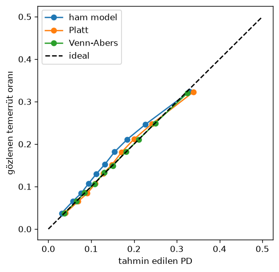

# Hafta 2.3: kalibrasyon raporu (test dilimi kullanılmadı)

Kalibrasyon dilimi: 81136 kayıt, gözlenen temerrüt oranı 0.1539. Metrikler leave-one-month-out (zaman bitişik 4 kat) ile, yani kalibratörün görmediği aylar üzerinde hesaplandı.

| Yöntem | Brier | LogLoss | ECE |
|---|---|---|---|
| raw | 0.1232 | 0.4022 | 0.0153 |
| platt | 0.1229 | 0.4012 | 0.0065 |
| venn_abers | 0.1229 | 0.4012 | 0.0013 |

## PD aralığı genişliği (p_high - p_low, katlar dışı)

| yüzdelik | 5 | 25 | 50 | 75 | 95 | 99 |
|---|---|---|---|---|---|---|
| genişlik | 0.0002 | 0.0003 | 0.0005 | 0.0008 | 0.0030 | 0.0094 |

## Ham skor ondalığına göre genişlik (veri desteği)

| ondalık | n | skor min | skor max | ort. genişlik |
|---|---|---|---|---|
| 0 | 8114 | 0.004 | 0.046 | 0.0018 |
| 1 | 8114 | 0.046 | 0.067 | 0.0005 |
| 2 | 8113 | 0.067 | 0.085 | 0.0006 |
| 3 | 8114 | 0.085 | 0.103 | 0.0007 |
| 4 | 8113 | 0.103 | 0.122 | 0.0007 |
| 5 | 8114 | 0.122 | 0.143 | 0.0005 |
| 6 | 8113 | 0.143 | 0.168 | 0.0008 |
| 7 | 8114 | 0.168 | 0.202 | 0.0005 |
| 8 | 8113 | 0.202 | 0.257 | 0.0008 |
| 9 | 8114 | 0.257 | 0.782 | 0.0026 |

Zayıf destek bölgesi (ort. genişlik > 2 × ondalık medyanı = 0.0014): ondalık 0 (skor 0.004-0.046, n=8114), ondalık 9 (skor 0.257-0.782, n=8114)

Son kalibratör (tüm kalibrasyon dilimi): aralıklar geçerli (0 ≤ low ≤ high ≤ 1), sha256 aadb48e1a1ad1e38…

